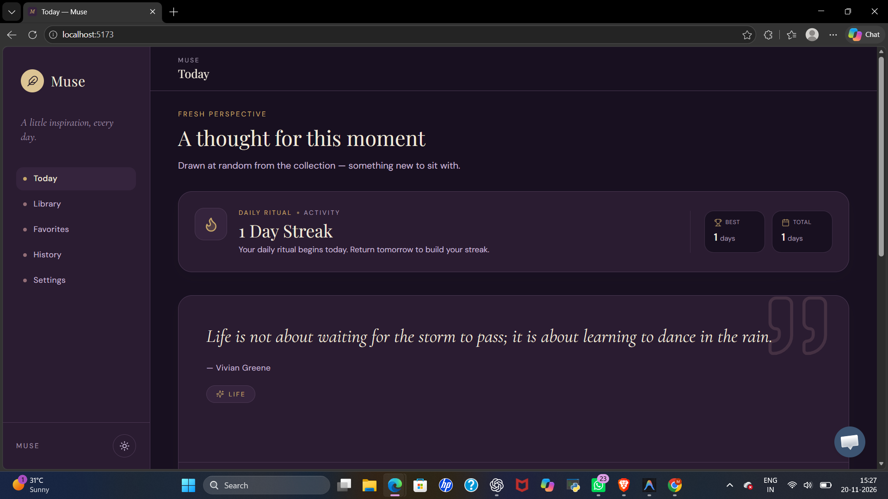
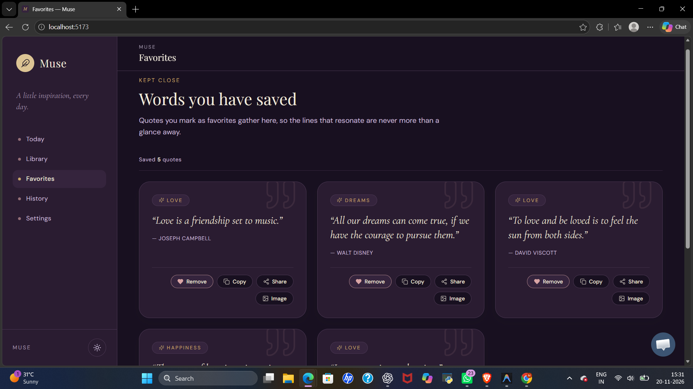
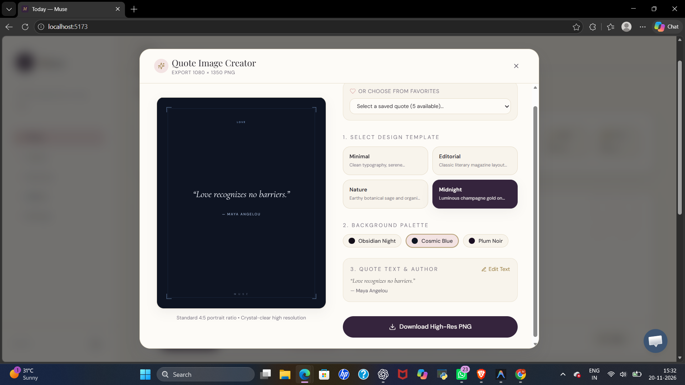

# 🌷 MUSE — Daily Inspiration

> *A little inspiration, every day.*

**MUSE** is a beautifully designed daily quote and inspiration app that helps you pause, reflect, and find motivation through meaningful words. Discover quotes based on your mood, save your favorites, explore your quote history, and create aesthetic quote images to share.

---

## ✨ Features

- 🌞 **Daily Quote** — Discover inspirational quotes every day.
- 🔄 **Quote Navigation** — Explore new quotes and revisit previous ones.
- 📋 **Copy Quotes** — Copy quotes with a single click.
- 📚 **Quote Library** — Browse, search, and filter quotes by category.
- 💗 **Favorites** — Save quotes you love and revisit them anytime.
- 🌈 **Mood-to-Muse** — Discover quotes that match your mood.
- 🕰️ **Quote History** — Revisit quotes you've discovered.
- 🔥 **Daily Streak** — Keep track of your inspiration habit.
- 🎨 **Quote Image Creator** — Customize quotes with templates and colors and export them as PNG images.
- 🌓 **Theme Settings** — Enjoy a theme that suits your preference.
- 📱 **Responsive Design** — Designed to work on desktop and mobile screens.

---

## 📸 Screenshots

### 🌞 Today


### 💗 Favorites


### 🎨 Quote Image Creator


---

## 🛠️ Tech Stack

- React
- TypeScript
- Vite
- Tailwind CSS

---

## 🚀 Getting Started

To run MUSE locally:

### 1. Clone the repository

```bash
git clone https://github.com/soundarya2428/muse-daily-inspiration.git
```

### 2. Navigate to the project folder

```bash
cd muse-daily-inspiration
```

### 3. Install dependencies

```bash
npm install
```

### 4. Start the development server

```bash
npm run dev
```

---

## 💌 About

MUSE was created to bring a little inspiration, reflection, and positivity into everyday life.

> *Sometimes, all you need is a few meaningful words.*